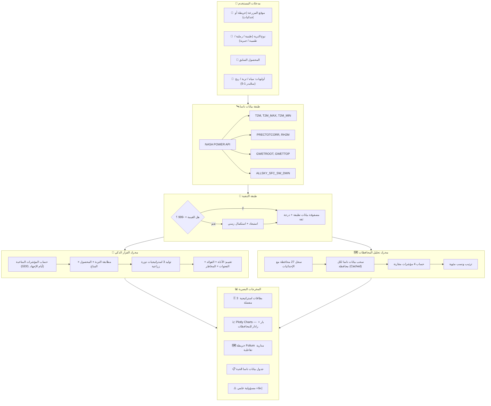

# 🛰️ أجرواوربت (AgroOrbit) — وثيقة الامبليمنتيشن الشاملة
### فريق نوفا سكواد ناسا (Nova Squad NASA)
**التحدي:** NASA Space Apps Challenge 2026 — Field Shift: Adapting Farms with NASA Data  
**المستوى:** Advanced / Intermediate  
**المجالات:** Earth Science · Software · Arts & Multimedia  
**المنصة:** Web & Mobile (Google Chrome)  

---

## 📑 فهرس الوثيقة
1. [تحليل الوضع الحالي للمشروع القديم (Current State Audit)](#1-تحليل-الوضع-الحالي-للمشروع-القديم)
2. [تحليل متطلبات ناسا الرسمية (NASA Requirements Mapping)](#2-تحليل-متطلبات-ناسا-الرسمية)
3. [المعمارية البرمجية الجديدة (New System Architecture)](#3-المعمارية-البرمجية-الجديدة)
4. [هيكل الملفات (File Structure)](#4-هيكل-الملفات)
5. [تفاصيل الامبليمنتيشن ملف بملف (Implementation Details)](#5-تفاصيل-الامبليمنتيشن-ملف-بملف)
6. [خطة التنفيذ بالمراحل والمراحل الفرعية (Execution Stages)](#6-خطة-التنفيذ-بالمراحل-والمراحل-الفرعية)
7. [اقتراحاتي وتقسيم الشغل (Suggestions & Work Division)](#7-اقتراحاتي-وتقسيم-الشغل)

---

## 1. تحليل الوضع الحالي للمشروع القديم

### 1.1 ماذا يوجد حالياً في المشروع القديم؟

| الملف | الوظيفة | الحالة |
|-------|---------|--------|
| `app.py` (179 سطر) | واجهة Streamlit + خريطة Folium + اتصال NASA POWER | يعمل جزئياً بمشاكل |
| `crops_data.csv` | 7 محاصيل + أمراضها | بيانات أولية محدودة |
| `FieldShift.bat` | ملف تشغيل | مسار خاطئ (مربوط بمسار جهاز آخر) |

### 1.2 نقاط الضعف الحرجة في الكود القديم

> [!CAUTION]
> **مشاكل جوهرية تمنع المشروع من المنافسة في ناسا بوضعه الحالي:**

1. **مشكلة فقدان البيانات بين الأزرار (State Loss):**
   * المتغير `temp_data` يُفقد بين ضغطات الأزرار بسبب عدم استخدام `st.session_state`. عندما المستخدم يضغط "جلب بيانات ناسا" ثم يضغط "اقترح دورة زراعية"، البيانات تختفي والشرط `if 'temp_data' in locals()` لا يتحقق أبداً.
2. **مسار ملف المحاصيل (Hardcoded Path):**
   * السطر `pd.read_csv(r"C:\Users\Eng\OneDrive\Desktop\crops_data.csv")` يشير لمسار جهاز آخر ولن يعمل على أي جهاز تاني.
3. **استايل بسيط جداً:** خلفية `#1E1E1E` فقط بدون أي هوية بصرية فضائية.
4. **محرك توصيات بدائي:** مجرد `if/elif` بسيط بدون محرك حقيقي للدورات الزراعية ثلاثية المواسم.
5. **لا يوجد مقارنة 3 استراتيجيات:** التحدي الرسمي يطلب بوضوح مقارنة **على الأقل 3 استراتيجيات** للدورة الزراعية.
6. **لا يوجد تحليل المحافظات:** ميزة تحليل ومقارنة المحافظات المصرية غير موجودة.
7. **لا يوجد فلترة القيم الشاذة (-999):** الفلتر موجود جزئياً فقط (سطر 74) لكنه لا يُستخدم في التوصيات.
8. **عدد المعاملات من ناسا محدود:** فقط `T2M` و `PRECTOTCORR`، بينما المشروع يحتاج `T2M_MAX`, `T2M_MIN`, `RH2M`, `GWETROOT`, `GWETTOP`, `ALLSKY_SFC_SW_DWN`.

---

## 2. تحليل متطلبات ناسا الرسمية

### 2.1 المطلوب من التحدي حسب ملف `details.txt` الرسمي

بناءً على قراءة دقيقة لصفحة التحدي الرسمية، الحكام يبحثون عن:


### 2.2 مصادر بيانات ناسا المتاحة حسب ملف `Resources.txt`

| المصدر | البيانات | كيف سنستخدمها في AgroOrbit |
|--------|---------|---------------------------|
| **NASA POWER API** | حرارة، رطوبة، إشعاع، هطول مطري | **الأساسي** — سحب مباشر عبر API لحساب المؤشرات المناخية |
| **SMAP** | رطوبة التربة السطحية والجذرية | مؤشر خصوبة التربة عبر `GWETROOT` و `GWETTOP` من POWER |
| **GPM / IMERG** | كميات الأمطار وتواترها | مؤشر كفاءة المياه عبر `PRECTOTCORR` من POWER |
| **MODIS** | مؤشرات الغطاء النباتي NDVI | ذكر في الوصف + إمكانية تطوير مستقبلي |
| **ECOSTRESS** | حرارة سطح الأرض والنتح | ذكر في الوصف للاستشهاد |
| **SRTM** | بيانات الارتفاع والتضاريس | ذكر في الوصف للاستشهاد |
| **FAO GAEZ** | ملاءمة المحاصيل عالمياً | دعم منطق التوصيات |
| **ESA Sentinel-2** | صور متعددة الأطياف 10-20م | ذكر كشريك فضائي |
| **ERA5 ECMWF** | بيانات مناخية تاريخية | ذكر في الوصف للاستشهاد |

### 2.3 خارطة المطابقة: أين يلبي المشروع الجديد كل نقطة من متطلبات ناسا

| متطلب ناسا الرسمي | أين يتحقق في AgroOrbit الجديد |
|-------------------|-------------------------------|
| استخدام بيانات SMAP, GPM, POWER, MODIS | `nasa_client.py` — سحب 8+ معاملات من POWER API |
| تحليل الحرارة والرطوبة والإجهاد | `decision_engine.py` — حساب GDD وأيام الإجهاد |
| بيانات تربة محلية | `crops_data.py` — قوام التربة + بصمة النيتروجين |
| أولويات المزارع (مياه، تربة، ربح) | الـ Sidebar — 3 سلايدرات أولويات + وزن ترجيحي |
| مقارنة 3+ استراتيجيات | `decision_engine.py` — توليد 3 سيناريوهات مختلفة |
| لكل استراتيجية: سبب + أدلة + فوائد + فجوات + مخاطر | بطاقات Expandable لكل استراتيجية بالتفصيل |
| كسر دورات الآفات | مصفوفة `pest_break_matrix` في محرك القرار |
| تحديد مواسم الأرض العارية | تحليل التغطية الموسمية في التقويم الزراعي |
| خرائط تفاعلية | `Folium` — خريطة مدارية + طبقة المحافظات |
| تصميم يناسب المزارع | واجهة عربية بسيطة + أيقونات بصرية واضحة |
| أداة مساعدة لا بديلة | إخلاء مسؤولية في كل صفحة توصيات |

---

## 3. المعمارية البرمجية الجديدة

### 3.1 مخطط تدفق النظام الكامل



### 3.2 مكدس التقنيات (Technology Stack)

| الطبقة | التقنية | الغرض |
|--------|---------|-------|
| اللغة | Python 3.10+ | لغة المشروع الأساسية |
| الواجهة | Streamlit | عرض تفاعلي سريع متجاوب |
| الخرائط | Folium + streamlit-folium | خرائط جغرافية تفاعلية |
| الرسوم البيانية | Plotly Express | تشارتات تفاعلية (بار، رادار) |
| البيانات | Pandas + NumPy | معالجة وتحليل البيانات |
| الاتصال بناسا | Requests | HTTP client لـ NASA POWER API |
| التخزين المؤقت | `st.cache_data` + JSON | كاش ذكي لبيانات المحافظات |
| الاستايل | CSS مخصص | ثيم فضائي NASA Mission Control |

---

## 4. هيكل الملفات

```
c:\Users\Mo7md\Desktop\task\
│
├── app.py                      ← نقطة الدخول الرئيسية (Streamlit Main App)
│
├── config.py                   ← الثوابت والإعدادات العامة (ألوان، مسارات، API URLs)
├── crops_data.py               ← قاعدة بيانات المحاصيل الشاملة (11 محصول + أمراض + نيتروجين)
├── egypt_governorates.py       ← سجل المحافظات الـ 27 (إحداثيات + تصنيف زراعي)
├── nasa_client.py              ← عميل الاتصال بـ NASA POWER API + فلتر -999
├── decision_engine.py          ← محرك اتخاذ القرار وتوليد 3 استراتيجيات
├── governorate_analyzer.py     ← محرك تحليل ومقارنة المحافظات
├── ui_components.py            ← مكونات الواجهة القابلة لإعادة الاستخدام
├── space_theme.py              ← CSS الثيم الفضائي الكامل
│
├── cache/                      ← مجلد التخزين المؤقت لبيانات المحافظات
│   └── governorates_baseline.json
│
├── crops_data.csv              ← (ملف قديم — سيُستبدل بـ crops_data.py)
├── AgroOrbit_System_Blueprint.md
├── AgroOrbit_Implementation.md ← (هذا الملف)
└── run_agroorbit.bat           ← ملف التشغيل السريع المحدث
```

---

## 5. تفاصيل الامبليمنتيشن ملف بملف

### 5.1 — `config.py` — الثوابت والإعدادات

**المسؤولية:** تجميع كل الثوابت في مكان واحد لسهولة التعديل.

**المحتوى:**
* `NASA_POWER_URL` — رابط الـ API
* `NASA_PARAMETERS` — قائمة المعاملات المطلوبة: `"T2M,T2M_MAX,T2M_MIN,PRECTOTCORR,RH2M,GWETROOT,GWETTOP,ALLSKY_SFC_SW_DWN"`
* `ANOMALY_VALUES` — القيم الشاذة: `[-999.0, -99.0]`
* `DEFAULT_DAYS` — عدد الأيام الافتراضي للاستعلام: `30`
* `CACHE_DIR` — مسار مجلد الكاش
* `SOIL_TYPES` — أنواع التربة المدعومة
* `COLORS` — ألوان الثيم الفضائي

---

### 5.2 — `crops_data.py` — قاعدة بيانات المحاصيل

**المسؤولية:** تخزين كل بيانات المحاصيل كـ Python dictionaries بدلاً من CSV لضمان الدقة والبنية المحكمة.

**البنية لكل محصول:**
```python
{
    "name_ar": "القمح",
    "name_en": "Wheat",
    "scientific_name": "Triticum aestivum",
    "season": "شتوي",           # شتوي / صيفي / نيلي
    "temp_min": 10,
    "temp_opt": 18,
    "temp_max": 25,
    "water_need": "medium",      # low / medium / high / very_high
    "water_mm_per_season": 450,
    "nitrogen_effect": "neutral", # improves / neutral / depletes
    "nitrogen_fixation_kg_ha": 0,
    "soil_suitability": ["clay", "loam"],
    "profit_level": "medium",
    "pest_families": ["rusts", "blight", "fungal"],
    "breaks_pest_cycle_of": ["maize", "rice"],
    "erosion_risk": "low",
    "organic_matter_contribution": "medium",
    "bare_field_months": [6, 7, 8],  # الأشهر التي تكون الأرض عارية بعده
}
```

**عدد المحاصيل:** 11 محصول — القمح، البرسيم، الذرة الشامية، الفول البلدي، الأرز، الطماطم، البصل، بنجر السكر، القطن، البطاطس، فول الصويا.

**مصفوفة كسر دورة الآفات (Pest Break Matrix):**
جدول يوضح أي محصول يكسر دورة آفات المحصول السابق.

---

### 5.3 — `egypt_governorates.py` — سجل المحافظات

**المسؤولية:** تخزين بيانات الـ 27 محافظة.

**البنية لكل محافظة:**
```python
{
    "name_ar": "الدقهلية",
    "name_en": "Dakahlia",
    "lat": 31.05,
    "lon": 31.38,
    "region": "delta",          # delta / upper / frontier / canal_coastal
    "region_ar": "الدلتا",
    "dominant_soil": "clay",
    "main_crops": ["rice", "wheat", "clover"],
    "agricultural_area_feddan": 580000,
}
```

**تقسيم المحافظات:**
* **الدلتا (8):** البحيرة، الشرقية، الدقهلية، الغربية، كفر الشيخ، المنوفية، القليوبية، دمياط
* **الصعيد والوسطى (9):** الجيزة، الفيوم، بني سويف، المنيا، أسيوط، سوهاج، قنا، الأقصر، أسوان
* **الحدود (5):** الوادي الجديد، مطروح، شمال سيناء، جنوب سيناء، البحر الأحمر
* **القناة والسواحل (5):** القاهرة، الإسكندرية، بورسعيد، الإسماعيلية، السويس

---

### 5.4 — `nasa_client.py` — عميل الاتصال بناسا

**المسؤولية:** الاتصال بـ NASA POWER API + تنقية البيانات.

**الدوال الرئيسية:**

| الدالة | الوظيفة |
|--------|---------|
| `fetch_nasa_data(lat, lon, days)` | سحب البيانات الخام من API |
| `clean_anomalies(data_dict)` | فلترة قيم `-999` واستبدالها |
| `interpolate_missing(values)` | استكمال القيم المفقودة بالمتوسط المتحرك |
| `calculate_confidence(original, cleaned)` | حساب نسبة ثقة البيانات (عدد القيم السليمة / الإجمالي) |
| `compute_climate_indices(cleaned_data)` | حساب المؤشرات: متوسط الحرارة، إجمالي الأمطار، متوسط رطوبة التربة |
| `fetch_governorate_data(gov_dict)` | سحب بيانات محافظة واحدة |
| `fetch_all_governorates_cached()` | سحب بيانات 27 محافظة مع كاش ذكي |

**آلية الكاش الذكي:**
* أول مرة → سحب من ناسا + حفظ في `cache/governorates_baseline.json` مع timestamp
* المرات التالية → قراءة من الكاش لو عمره أقل من 24 ساعة
* زر "تحديث حي" → يتجاوز الكاش ويسحب من ناسا مباشرة

**معاملات ناسا المسحوبة (8 معاملات):**
`T2M`, `T2M_MAX`, `T2M_MIN`, `PRECTOTCORR`, `RH2M`, `GWETROOT`, `GWETTOP`, `ALLSKY_SFC_SW_DWN`

---

### 5.5 — `decision_engine.py` — محرك اتخاذ القرار الذكي

**المسؤولية:** الجوهر العلمي للتطبيق — توليد 3 استراتيجيات دورة زراعية مقارنة.

**المدخلات:**
* بيانات ناسا المنقاة (من `nasa_client.py`)
* نوع التربة
* المحصول السابق
* أولويات المزارع الـ 3 (مياه، تربة، ربح)

**الدوال الرئيسية:**

| الدالة | الوظيفة |
|--------|---------|
| `filter_suitable_crops(soil, climate)` | فلترة المحاصيل الملائمة حرارياً وتربوياً |
| `score_crop(crop, priorities, climate, prev_crop)` | تسجيل نقاط لكل محصول حسب الأولويات |
| `generate_rotation(crops_scored, seasons=3)` | بناء تسلسل 3 مواسم بمنطق تدوير |
| `generate_3_strategies(...)` | توليد 3 استراتيجيات مختلفة |
| `build_strategy_card(strategy)` | بناء بطاقة تفصيلية لكل استراتيجية |

**الاستراتيجيات الثلاث المُولَّدة:**

1. **🟢 الاستراتيجية الأولى — Baseline (الدورة الحالية/التقليدية):**
   * تكرار المحصول الحالي أو الدورة المعتادة
   * تقييم نقاط ضعفها: استنزاف نيتروجين، تراكم آفات، استهلاك مياه
   * **الهدف:** إعطاء المزارع مقارنة عادلة مع الوضع القائم

2. **🔵 الاستراتيجية الثانية — صحة التربة والنيتروجين (Soil Health & BNF):**
   * تعظيم إدراج المحاصيل البقولية المثبتة للنيتروجين
   * كسر دورة حياة الآفات الفطرية والحشرية
   * تحسين المادة العضوية في التربة
   * **الهدف:** تقليل الأسمدة الكيماوية + تحسين بنية التربة

3. **🟠 الاستراتيجية الثالثة — التكيف المائي والمناخي (Water Resilience):**
   * تقليل استهلاك مياه الري بالتدوير مع محاصيل منخفضة الاحتياج
   * اختيار محاصيل تتحمل الإجهاد الحراري حسب بيانات ناسا
   * **الهدف:** أقصى كفاءة مائية + تكيف مع الموجات الحرارية

**بطاقة كل استراتيجية تحتوي على:**
* ✅ **لماذا اقترحناها** (Why Suggested) — المنطق العلمي
* 📊 **الأدلة الفضائية** (Evidence) — بيانات ناسا الداعمة
* 🌟 **الفوائد المتوقعة** (Benefits) — تقديرات كمية
* ⚠️ **فجوات المعلومات** (Information Gaps) — ما لا نستطيع قياسه فضائياً
* 🔴 **المخاطر التي تحتاج مراجعة محلية** (Risks) — تحذيرات للخبير

**خوارزمية التسجيل (Scoring Algorithm):**
```
Score(crop) = (W_water × water_score) + (W_soil × soil_score) + (W_profit × profit_score)
            + nitrogen_bonus + pest_break_bonus - same_family_penalty
```
حيث `W_water`, `W_soil`, `W_profit` هي أوزان أولويات المزارع (السلايدرات).

---

### 5.6 — `governorate_analyzer.py` — محرك تحليل المحافظات

**المسؤولية:** حساب المؤشرات المقارنة لـ 27 محافظة وترتيبها.

**المؤشرات الأربعة:**

1. **مؤشر خصوبة التربة (0-100%):**
   ```
   fertility = normalize(avg_GWETROOT × 0.6 + avg_GWETTOP × 0.4) × 100
   ```

2. **مؤشر كفاءة المياه (0-100%):**
   ```
   water_eff = normalize(avg_PRECTOTCORR / (avg_T2M × avg_ALLSKY_SFC_SW_DWN)) × 100
   ```
   (كلما زادت الأمطار مقابل البخر، زادت الكفاءة)

3. **مؤشر الملاءمة الحرارية (0-100%):**
   ```
   thermal = normalize(1 - (days_above_38 / total_days)) × 100
   ```

4. **المؤشر الشامل (AgroOrbit Score):**
   ```
   composite = (fertility × 0.35) + (water_eff × 0.35) + (thermal × 0.30)
   ```

**الدوال:**

| الدالة | الوظيفة |
|--------|---------|
| `compute_all_indices(gov_data)` | حساب الـ 4 مؤشرات لكل محافظة |
| `rank_governorates(index_name)` | ترتيب المحافظات حسب مؤشر معين |
| `build_bar_chart(ranked, index)` | بناء Plotly بار تشارت أفقي |
| `build_radar_chart(gov_name, indices)` | بناء Plotly رادار تشارت لمحافظة واحدة |
| `build_map_layer(ranked, index)` | بناء طبقة Folium ملونة على الخريطة |

---

### 5.7 — `space_theme.py` — الثيم الفضائي

**المسؤولية:** إرجاع CSS string كامل يُحقن في Streamlit عبر `st.markdown(unsafe_allow_html=True)`.

**عناصر التصميم:**

| العنصر | التفصيل |
|--------|---------|
| **خلفية الجسم** | تدرج شعاعي (Radial Gradient) من `#080c14` إلى `#0e1626` مع نجوم خافتة متحركة بالـ CSS |
| **البطاقات** | `background: rgba(16, 26, 46, 0.75)` مع `backdrop-filter: blur(12px)` و `border: 1px solid rgba(0, 229, 255, 0.15)` |
| **العناوين** | لون سيان مداري `#00e5ff` مع توهج خفيف `text-shadow` |
| **الأزرار** | تدرج من `#00e5ff` إلى `#00ff88` مع تأثير hover متوهج |
| **التنبيهات الإيجابية** | حدود `#00ff88` (أخضر زراعي) |
| **التحذيرات** | حدود `#ff9100` (برتقالي شمسي) |
| **الأخطاء** | حدود `#ff3d71` (أحمر إنذار) |
| **الـ Sidebar** | خلفية أغمق `#060a12` مع شريط جانبي يشبه لوحة التحكم |
| **Metric Cards** | بطاقات مؤشرات KPI بإطار متوهج ورقم كبير |
| **توافق الموبايل** | `@media (max-width: 768px)` لتحويل الأعمدة لصف واحد |

---

### 5.8 — `ui_components.py` — مكونات الواجهة

**المسؤولية:** دوال مساعدة لبناء عناصر الواجهة المتكررة.

**الدوال:**

| الدالة | الوظيفة |
|--------|---------|
| `render_telemetry_card(icon, title, value, unit, color)` | عرض بطاقة مؤشر تليمتري فضائية |
| `render_strategy_card(strategy_dict)` | عرض بطاقة استراتيجية كاملة بالتفصيل |
| `render_confidence_badge(confidence_pct)` | شارة ثقة البيانات (أخضر > 90%، أصفر > 70%، أحمر) |
| `render_disclaimer()` | عرض إخلاء المسؤولية العلمي بتصميم موحد |
| `render_nasa_credit()` | عرض بيانات المصادر وحقوق ناسا |

---

### 5.9 — `app.py` — نقطة الدخول الرئيسية

**المسؤولية:** تجميع كل المكونات وبناء واجهة Streamlit النهائية.

**هيكل الصفحة (من أعلى لأسفل):**

```
┌─────────────────────────────────────────────────┐
│  🛰️ AgroOrbit — أجرواوربت                        │
│  أداة دعم القرار الزراعي بالبيانات الفضائية       │
├─────────────────────────────────────────────────┤
│                                                 │
│  ┌─────────┐ ┌─────────┐ ┌─────────┐ ┌────────┐│
│  │🌡️ حرارة │ │🌧️ أمطار │ │💧 رطوبة │ │☀️ إشعاع││
│  │ 27.3°C  │ │ 1.2mm   │ │  68%    │ │ 5.4    ││
│  └─────────┘ └─────────┘ └─────────┘ └────────┘│
│                                                 │
│  📍 خريطة تفاعلية (Folium)                       │
│  ┌─────────────────────────────────────────────┐│
│  │                                             ││
│  │         [خريطة فضائية داكنة]                  ││
│  │         مع Pin للمزرعة                        ││
│  │                                             ││
│  └─────────────────────────────────────────────┘│
│                                                 │
│  🧠 استراتيجيات الدورة الزراعية (3 بطاقات)        │
│  ┌──────────┐ ┌──────────┐ ┌──────────┐         │
│  │🟢 Baseline│ │🔵 تربة   │ │🟠 مياه    │         │
│  │ الدورة   │ │ ونيتروجين│ │ وتكيف    │         │
│  │ الحالية  │ │          │ │ مناخي    │         │
│  └──────────┘ └──────────┘ └──────────┘         │
│                                                 │
│  🗺️ تحليل المحافظات المصرية                      │
│  ┌─────────────────────────────────────────────┐│
│  │  [تشارت بار أفقي — ترتيب المحافظات]          ││
│  └─────────────────────────────────────────────┘│
│  ┌─────────────────────────────────────────────┐│
│  │  [خريطة المحافظات الملونة]                    ││
│  └─────────────────────────────────────────────┘│
│                                                 │
│  ⚠️ إخلاء مسؤولية علمي                           │
│  📡 مصادر البيانات وحقوق ناسا                    │
└─────────────────────────────────────────────────┘

┌── SIDEBAR ──────────────┐
│ 📋 بيانات المزرعة       │
│ • نوع التربة [Dropdown] │
│ • المحصول السابق        │
│ 🎯 أولوياتك             │
│ • توفير المياه [1-5]    │
│ • صحة التربة [1-5]     │
│ • الربح [1-5]          │
│ 📍 الموقع               │
│ • Lat / Lon             │
│ 🚀 [اقترح دورات زراعية] │
│                         │
│ 🛰️ بيانات ناسا          │
│ 🔄 [جلب بيانات الطقس]   │
│                         │
│ 🗺️ تحليل المحافظات      │
│ • اختر المعيار          │
│ 📊 [قارن المحافظات]      │
│                         │
│ 📊 بيانات المحاصيل      │
│ [جدول المحاصيل المتاحة]  │
└─────────────────────────┘
```

**استخدام `st.session_state`:**
* `st.session_state.nasa_data` — بيانات ناسا المسحوبة
* `st.session_state.cleaned_data` — البيانات بعد التنقية
* `st.session_state.strategies` — الاستراتيجيات الثلاث المولّدة
* `st.session_state.gov_results` — نتائج تحليل المحافظات
* `st.session_state.confidence` — مؤشر ثقة البيانات

---

## 6. خطة التنفيذ بالمراحل والمراحل الفرعية


### تفصيل المراحل:

#### 🚀 المرحلة الأولى — البنية التحتية وقواعد البيانات (Stage 1)
| الرقم | الملف | المحتوى | الحجم التقديري |
|-------|-------|---------|---------------|
| 1.1 | `config.py` | ثوابت API، ألوان، مسارات، قوائم | ~60 سطر |
| 1.2 | `crops_data.py` | 11 محصول × 15 معامل + مصفوفة الآفات | ~250 سطر |
| 1.3 | `egypt_governorates.py` | 27 محافظة × 9 حقول | ~200 سطر |

#### 🛰️ المرحلة الثانية — محرك بيانات ناسا (Stage 2)
| الرقم | الملف | المحتوى | الحجم التقديري |
|-------|-------|---------|---------------|
| 2.1 | `nasa_client.py` (جزء 1) | `fetch_nasa_data()` + error handling | ~80 سطر |
| 2.2 | `nasa_client.py` (جزء 2) | `clean_anomalies()` + `interpolate_missing()` + `calculate_confidence()` | ~100 سطر |
| 2.3 | `nasa_client.py` (جزء 3) | `fetch_all_governorates_cached()` + كاش JSON | ~80 سطر |

#### 🧠 المرحلة الثالثة — محرك القرار الذكي (Stage 3)
| الرقم | الملف | المحتوى | الحجم التقديري |
|-------|-------|---------|---------------|
| 3.1 | `decision_engine.py` (جزء 1) | `filter_suitable_crops()` + `score_crop()` | ~120 سطر |
| 3.2 | `decision_engine.py` (جزء 2) | `generate_3_strategies()` | ~150 سطر |
| 3.3 | `decision_engine.py` (جزء 3) | `build_strategy_card()` مع الأدلة والفجوات | ~100 سطر |

#### 🎨 المرحلة الرابعة — الواجهة الفضائية (Stage 4)
| الرقم | الملف | المحتوى | الحجم التقديري |
|-------|-------|---------|---------------|
| 4.1 | `space_theme.py` | CSS كامل + نجوم + glassmorphism + موبايل | ~200 سطر |
| 4.2 | `ui_components.py` | دوال البطاقات والمؤشرات | ~150 سطر |
| 4.3 | `app.py` | التجميع النهائي مع session_state | ~350 سطر |

#### 🗺️ المرحلة الخامسة — الخرائط والتشارتات (Stage 5)
| الرقم | الملف | المحتوى | الحجم التقديري |
|-------|-------|---------|---------------|
| 5.1 | (ضمن `app.py`) | خريطة Folium فضائية + Pin المزرعة | مدمج |
| 5.2 | `governorate_analyzer.py` | حساب المؤشرات + Plotly Charts | ~200 سطر |
| 5.3 | (ضمن `governorate_analyzer.py`) | طبقة المحافظات الملونة على الخريطة | مدمج |

#### 🧪 المرحلة السادسة — التحقق والإطلاق (Stage 6)
| الرقم | الملف | المحتوى | الحجم التقديري |
|-------|-------|---------|---------------|
| 6.1 | (اختبار يدوي) | Chrome Mobile Emulation 375px / 412px | — |
| 6.2 | (اختبار يدوي) | بيانات شاذة + انقطاع اتصال | — |
| 6.3 | `run_agroorbit.bat` | ملف تشغيل بمسار صحيح | ~5 أسطر |

---

## 7. اقتراحاتي وتقسيم الشغل

### 7.1 اقتراحات إضافية لتقوية المشروع أمام حكام ناسا

> [!TIP]
> **اقتراحات من شأنها رفع درجة المشروع بشكل ملحوظ في التحكيم:**

#### اقتراح 1: 📅 التقويم الزراعي الموسمي (Seasonal Crop Calendar)
إضافة شريط زمني بصري (Timeline) يوضح لكل استراتيجية متى تزرع ومتى تحصد ومتى تكون الأرض عارية. ناسا طلبت صراحة: *"highlight times when fields are typically bare"*.

#### اقتراح 2: 🔄 زر تبديل اللغة (AR / EN Toggle)
حكام ناسا غالبيتهم إنجليز. إضافة زر تبديل فوري بين العربية والإنجليزية يرفع إمكانية الوصول وييسّر التحكيم الدولي بدون فقد الطابع المحلي.

#### اقتراح 3: 📊 مقارنة الاستراتيجيات جنباً إلى جنب (Side-by-Side Comparison Table)
جدول واحد يقارن الـ 3 استراتيجيات في: استهلاك المياه، ربح متوقع، أثر النيتروجين، كسر الآفات. ناسا طلبت: *"compare at least three rotation strategies"*.

#### اقتراح 4: 🌡️ سلايدر سيناريو "ماذا لو" (What-If Scenario Slider)
ناسا اقترحت صراحة: *"scenario sliders that adjust rainfall or temperature patterns"*. إضافة سلايدر يسمح بتعديل الحرارة ±2°C أو الأمطار ±20% ورؤية تأثير ذلك على التوصيات مباشرة.

#### اقتراح 5: 📥 تصدير التقرير (Export Report)
زر لتحميل ملخص التوصيات كـ PDF أو نسخه كنص — يسهل على المزارع مشاركة التقرير مع مهندس زراعي.

---

### 7.2 تقسيم الشغل المقترح

#### الخيار أ: تنفيذ متسلسل (شخص واحد / أنا أنفذ بالكامل)

| الترتيب | المرحلة | الوقت التقديري |
|---------|---------|---------------|
| 1️⃣ | المرحلة 1: البنية التحتية (config + crops + governorates) | أول جولة |
| 2️⃣ | المرحلة 2: محرك ناسا (nasa_client كامل) | ثاني جولة |
| 3️⃣ | المرحلة 3: محرك القرار (decision_engine كامل) | ثالث جولة |
| 4️⃣ | المرحلة 4: الواجهة الفضائية (theme + components + app.py) | رابع جولة |
| 5️⃣ | المرحلة 5: تحليل المحافظات + خرائط + تشارتات | خامس جولة |
| 6️⃣ | المرحلة 6: اختبار + ملف تشغيل + تحسينات نهائية | سادس جولة |

#### الخيار ب: تنفيذ متوازي (لو فيه أكثر من شخص في الفريق)

| المطور | المسؤولية |
|--------|-----------|
| **مطور 1 (Backend)** | `nasa_client.py` + `decision_engine.py` + `governorate_analyzer.py` |
| **مطور 2 (Frontend)** | `space_theme.py` + `ui_components.py` + التصميم والموبايل |
| **مطور 3 (Data)** | `crops_data.py` + `egypt_governorates.py` + `config.py` + اختبار |
| **التجميع** | `app.py` — يجمعه أي حد بعد ما كل الملفات تتعمل |

---

### 7.3 ملاحظات مهمة قبل البدء

> [!IMPORTANT]
> **نقاط حرجة:**

1. **`st.session_state` أساسي:** بدونه ستُفقد بيانات ناسا بين كل ضغطة زر — وده كان أكبر مشكلة في الكود القديم.
2. **مسارات الملفات نسبية:** كل الملفات ستستخدم مسارات نسبية (`./cache/`) وليست مطلقة (`C:\Users\...`).
3. **ملف `requirements.txt`:** سأنشئه لضمان تثبيت كل المكتبات بأمر واحد.
4. **التعامل مع فشل الاتصال بناسا:** كل استعلام API ملفوف بـ `try/except` مع رسالة واضحة.
5. **لا نحتاج مفتاح API:** ناسا POWER API متاح مجاناً بدون تسجيل أو مفتاح.

---

> 🚀 **الوثيقة جاهزة. بمجرد إشارتك "ابدأ"، سأنفذ المرحلة الأولى (config.py + crops_data.py + egypt_governorates.py) فوراً.**
