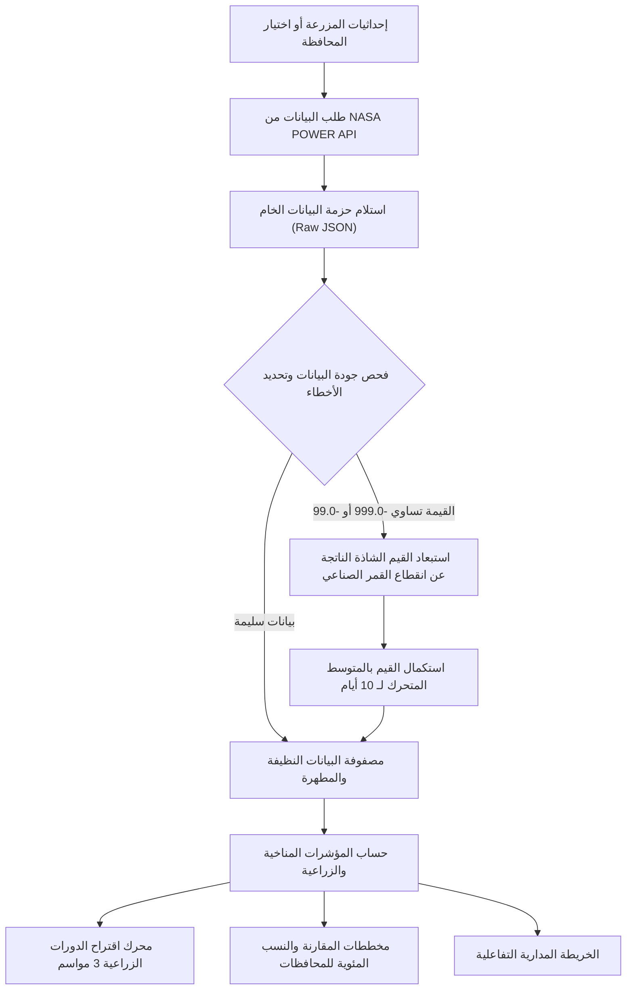

# 🛰️ مشروع أجرواوربت (AgroOrbit) — وثيقة المعمارية والمخطط الهندسي الشامل
**الفريق:** نوفا سكواد ناسا (Nova Squad NASA)  
**مسار التحدي:** تحدي ناسا لتطبيقات الفضاء 2026 (NASA Space Apps Challenge 2026) — *تغيير الميدان: تكييف المزارع ببيانات ناسا (Field Shift: Adapting Farms with NASA Data)*  
**نوع المنصة:** تطبيق تفاعلي متعدد المنصات (Web & Mobile) — مهيأ بالكامل للعرض واختبار الموبايل على متصفح جوجل كروم (Google Chrome Mobile Emulation)  

---

## 📑 فهرس المحتويات
1. [الوصف الرسمي للمشروع (المقدم للجنة تحكيم ناسا)](#1-الوصف-الرسمي-للمشروع-المقدم-للجنة-تحكيم-ناسا)
   - 1.1 هوية المشروع ورؤيته (Project Identity & Vision)
   - 1.2 المعمارية التقنية وتكامل بيانات ناسا (Core Technical Architecture & NASA Integration)
   - 1.3 محرك اتخاذ القرار الزراعي الذكي (The Smart Decision Engine)
   - 1.4 الأثر البيئي والاقتصادي وقابلية التوسع (Impact & Scalability)
   - 1.5 إخلاء المسؤولية العلمية والحدود الفنية (Honesty & Uncertainty Disclaimers)
2. [تصميم واجهة المستخدم بطابع الفضاء وتجربة الموبايل (UI/UX Space Theme)](#2-تصميم-واجهة-المستخدم-بطابع-الفضاء-وتجربة-الموبايل-uiux-space-theme)
3. [مصفوفة الذكاء الزراعي والمناخي لمحافظات مصر (27 محافظة)](#3-مصفوفة-الذكاء-الزراعي-والمناخي-لمحافظات-مصر-27-محافظة)
4. [مسار معالجة بيانات ناسا وفلترة القيم الشاذة (-999)](#4-مسار-معالجة-بيانات-ناسا-وفلترة-القيم-الشاذة--999)
5. [خطة التنفيذ التفصيلية مقسمة إلى مراحل ومراحل فرعية (Stages & Sub-Stages)](#5-خطة-التنفيذ-التفصيلية-مقسمة-إلى-مراحل-ومراحل-فرعية-stages--sub-stages)
6. [الأسئلة التوضيحية وإشارة البدء](#6-الأسئلة-التوضيحية-وإشارة-البدء)

---

## 1. الوصف الرسمي للمشروع (المقدم للجنة تحكيم ناسا)

### 1.1 هوية المشروع ورؤيته (Project Identity & Vision)
مشروع **"أجرواوربت" (AgroOrbit)** هو منظومة متقدمة لدعم القرار الزراعي تركز بالأساس على المزارع، وتهدف إلى سد الفجوة الكبيرة بين بيتابايتات البيانات الفضائية الخام الصادرة عن مراصد وكالة ناسا لرصد الأرض (NASA Earth Observations) وبين القرارات العملية اليومية على أرض الواقع الزراعي. 

في ظل التغيرات المناخية المتسارعة وغير المسبوقة عالمياً، انهارت المواقيت الزراعية المتوارثة عبر الأجيال؛ فأصبحت معدلات هطول الأمطار مضطربة، وضاق المدى الحراري الملائم لنمو المحاصيل، كما أدى التكرار المستمر لزراعة المحصول الواحد دون تخطيط إلى استنزاف خصوبة التربة وتدهور الكائنات الحية الدقيقة بها، فضلًا عن إهدار الموارد المائية الشحيحة. 

رؤية **AgroOrbit** ترتكز على إتاحة العلوم المدارية للجميع (Democratizing Orbital Science) من خلال تحويل القياسات الفضائية الطيفية المعقدة إلى توصيات زراعية فورية ودقيقة. فبدلاً من عرض مصفوفات إحصائية جافة لا يفهمها المزارع، يقدم النظام مسارات ذكية لتدوير المحاصيل عبر مواسم متعددة، واستراتيجيات مخصصة لتوفير مياه الري، وحلولاً عملية لاستعادة حيوية التربة مباشرة عبر شاشة الهاتف المحمول.

---

### 1.2 المعمارية التقنية وتكامل بيانات ناسا (Core Technical Architecture & NASA Integration)
تم بناء منظومة **AgroOrbit** استناداً إلى معمارية بايثون مرنة تجمع بين **Streamlit** للعرض التفاعلي السريع للتليمترية الفضائية، ومكتبة **Folium / Leaflet** للخرائط الجغرافية التفاعلية وطبقات الكوروبليث (Choropleth Maps). 

يتصل النظام مباشرة بقنوات بيانات علوم الأرض التابعة لوكالة ناسا، وفي مقدمتها واجهة برمجة التطبيقات الزراعية المناخية **NASA POWER API (Prediction Of Worldwide Energy Resources)**، مع هيكلة برمجية تدعم وتتكامل مع بيانات المهمات الفضائية التالية:
* **SMAP (Soil Moisture Active Passive):** قياسات رطوبة التربة السطحية والجذرية.
* **GPM (Global Precipitation Measurement):** رصد وتصحيح كميات الهطول المطري ومعدلات الجفاف.
* **MODIS (Moderate Resolution Imaging Spectroradiometer):** مؤشرات الغطاء النباتي وديناميكية النتح والكتلة الحيوية.

#### القياسات والمعاملات الفضائية المستخرجة:
* **درجات الحرارة:** درجة حرارة الهواء على ارتفاع مترين (`T2M`)، والحدود القصوى (`T2M_MAX`) والدنيا (`T2M_MIN`).
* **الأمطار والرطوبة:** الهطول المطري المصحح (`PRECTOTCORR`)، والرطوبة النسبية (`RH2M`).
* **الإشعاع الشمسي:** الإشعاع الكلي الساقط على السطح (`ALLSKY_SFC_SW_DWN`) لحساب التبخر والاحتياج الضوئي.
* **رطوبة التربة المدارية:** رطوبة التربة في النطاق الجذري (`GWETROOT`) ورطوبة السطح (`GWETTOP`) المستمدة من نماذج MERRA-2 والمعايرة مع مقاييس إشعاع SMAP.

#### فلتر تنقية البيانات والتعامل مع القيم الشاذة (-999):
تتعرض أجهزة الاستشعار بالأقمار الصناعية أحياناً لفقدان الإشارة أثناء الدوران المداري، فتُسجل قيم الغياب أو العيوب برقم كودي شاذ وهو `-999.0` أو `-99.0`. يمتلك نظام AgroOrbit فلتر تنقية ذاتي يقوم بما يلي:
1. عزل واستبعاد هذه القيم الشاذة فور استلام كائن الـ JSON من سيرفرات ناسا.
2. تطبيق خوارزمية الاستكمال الزمني الخطي (Temporal Linear Interpolation) بالاعتماد على متوسط متحرك لـ 10 أيام سابقة لضمان استمرارية التحليل دون تشويه النماذج.
3. حساب مؤشر ثقة البيانات الفضائية (Data Confidence Score) لعرضه للمستخدم.

---

### 1.3 محرك اتخاذ القرار الزراعي الذكي (The Smart Decision Engine)
يعمل في قلب AgroOrbit محرك استدلال زراعي ذكي يطابق ويحلل 3 طبقات رئيسية لإنتاج خطة دورة زراعية متعاقبة (3 إلى 4 مواسم):
1. **النطاق المناخي الفضائي (Dynamic Climate Envelope):** حساب الوحدات الحرارية التراكمية اللازمة للنمو (Growing Degree Days - GDD)، وعدّ الأيام ذات الإجهاد الحراري الشديد مقارنة بالحدود الفسيولوجية لكل محصول ($T_{base}, T_{opt}, T_{max}$).
2. **خصائص التربة وقوامها (Edaphic Classification):** مطابقة نوع التربة (طينية، رملية، طميية، جيرية) وسعتها الحقلية وقدرتها على تصريف المياه.
3. **التاريخ الزراعي وميزان النيتروجين (Biological Legacy & Nitrogen Dynamics):** دراسة تأثير المحصول السابق لتفادي استنزاف التربة واستغلال التثبيت الحيوي للنيتروجين (Biological Nitrogen Fixation). فعلى سبيل المثال: بعد زراعة محصول مجهد للنيتروجين مثل الذرة الشامية (*Zea mays*)، يقترح النظام تلقائياً زراعة محصول بقولي مخصب مثل البرسيم (*Trifolium alexandrinum*) أو الفول البلدي (*Vicia faba*)، يليه محصول ذو استهلاك معتدل.

#### الأولويات المخصصة للمزارع:
يتيح النظام للمزارع تحديد أولوياته عبر مؤشرات دقيقة:
* **توفير مياه الري (Water Conservation)**
* **تحسين صحة وخصوبة التربة (Soil Health)**
* **العائد الاقتصادي والربحية (Profit Maximization)**

كما يصدر المحرك تحذيرات استباقية لكسر دورات الآفات والأمراض الفطرية والحشرية (مثل أصداء القمح، لفحة الذرة، ونيماتودا الجذور).

---

### 1.4 الأثر البيئي والاقتصادي وقابلية التوسع (Impact & Scalability)
يحقق تطبيق AgroOrbit أهداف التنمية المستدامة للأمم المتحدة (SDG 2: القضاء على الجوع، SDG 6: المياه النظيفة، SDG 13: العمل المناخي):
* **كفاءة استهلاك المياه:** تقليل الفاقد في مياه الري بنسبة تتراوح بين **22% إلى 30%** في البيئات الجافة وشبه الجافة كحوض النيل ومشاريع الاستصلاح الصحراوي.
* **خفض استهلاك الأسمدة الكيماوية:** استعادة النيتروجين الطبيعي عبر الدورات التكافلية مما يقلل الاعتماد على اليوريا ونترات النشادر بنسبة تصل إلى **20%**، مخفضاً التكاليف وانبعاثات أكسيد النيتروز.
* **إتاحة وسهولة استخدام في الأرياف:** معمارية برمجية خفيفة مصممة لشبكات الإنترنت الضعيفة، مع مؤشرات بصرية مفهومة لا تتطلب خلفية تقنية معقدة.

---

### 1.5 إخلاء المسؤولية العلمية والحدود الفنية (Honesty & Uncertainty Disclaimers)
تقتضي الأمانة العلمية في مسابقات ناسا الدولية توضيح الحدود التقنية بدقة:
* **دقة رصد الأقمار الصناعية مقابل مساحة الحقل:** تأتي بيانات ناسا الزراعية عبر شبكات بمقياس تقريبي $0.5^\circ \times 0.625^\circ$ (أي حوالي 50 كم). هذا المقياس ممتاز لمراقبة أنماط الطقس الإقليمية، والإشعاع الشمسي، ومتطلبات البخر نتح الكلية، لكنه لا يرصد التباينات الدقيقة بين خطوط الري بالتنقيط داخل الحوض الزراعي الفردي أو الفروق الدقيقة في ملوحة التربة من متر لآخر.
* **نظام لدعم القرار وليس بديلاً عن الخبير:** تم تصميم AgroOrbit كأداة استرشادية ذكية مساعدة للمزارع والمهندس الزراعي، ولا يغني عن الفحص المعملي الميداني للتربة والمياه أو الاستشارات الإرشادية المحلية المتخصصة.

---

## 2. تصميم واجهة المستخدم بطابع الفضاء وتجربة الموبايل (UI/UX Space Theme)

### 2.1 الهوية البصرية الفضائية (NASA Mission Control Theme)
* **ألوان الفضاء العميق (Deep Space Palette):**
  * خلفية كوزمية معتمة بدرجات السواد الفضائي والكحلي السديمي (`#080c14` و `#0d1527`).
  * بطاقات زجاجية عائمة (Glassmorphism) بشفافية وتأثير ضبابي (`backdrop-filter: blur(12px)`).
  * خطوط توهج نيونية مدارية مستوحاة من رادارات ناسا: السيان المداري (`#00e5ff`)، والأخضر الزراعي الحيوي (`#00ff88`)، والبرتقالي الشمسي للتنبيهات (`#ff9100`).
* **بطاقات التيليمترية والمؤشرات:** عرض درجات الحرارة والرطوبة وكفاءة المحافظات في صورة بطاقات تليمترية مزودة بأيقونات الأقمار الصناعية ورسوم بيانية صغيرة (Sparklines).

### 2.2 التوافق التام مع الموبايل عبر جوجل كروم (Mobile-First on Chrome)
* ضبط استعلامات الوسائط (CSS Media Queries) لتتحول الشاشة إلى عمود انسيابي مريح وسهل التصفح عند تفعيل وضع الموبايل (Chrome Device Emulation) بأبعاد الهواتف الشائعة (مثل iPhone 14/15 و Samsung Galaxy).
* أزرار كبيرة سهلة اللمس، وقوائم سحب منزلقة واضحة تناسب إبهام اليد أثناء تصفح المزارع.

---

## 3. مصفوفة الذكاء الزراعي والمناخي لمحافظات مصر (27 محافظة)

### 3.1 التوزيع الجغرافي للمحافظات
تم تضمين إحداثيات ومراكز كافة محافظات الجمهورية الـ 27 موزعة جغرافياً:
* **محافظات الدلتا والوجه البحري:** البحيرة، الشرقية، الدقهلية، الغربية، كفر الشيخ، المنوفية، القليوبية، دمياط.
* **محافظات مصر الوسطى والصعيد:** الجيزة، الفيوم، بني سويف، المنيا، أسيوط، سوهاج، قنا، الأقصر، أسوان.
* **محافظات الحدود والاستصلاح الحديث:** الوادي الجديد، مطروح، شمال سيناء، جنوب سيناء، البحر الأحمر.
* **محافظات القناة والسواحل والحضر:** الإسكندرية، بورسعيد، الإسماعيلية، السويس، القاهرة.

### 3.2 المعايير والمؤشرات القابلة للاختيار والمقارنة
يمكن للمستخدم تحديد أي من المعايير التالية لعرض ترتيب المحافظات:
1. **مؤشر خصوبة ورطوبة التربة (Soil Fertility & Moisture Index):** محسوب استناداً إلى رطوبة المنطقة الجذرية (`GWETROOT`) ورطوبة السطح (`GWETTOP`).
2. **مؤشر كفاءة وتوفير مياه الري (Water Efficiency Index):** النسبة العكسية للعجز المائي (مقارنة الأمطار `PRECTOTCORR` بالإشعاع الشمسي والبخر).
3. **مؤشر الملاءمة الحرارية وتجنب الإجهاد (Thermal Crop Suitability):** حساب مدى استقرار درجات الحرارة وتجنب موجات الحر الشديدة ($> 38^\circ\text{C}$).
4. **مؤشر أجرواوربت الإنتاجي الشامل (AgroOrbit Composite Productivity):** تجميع وزني لكافة المعايير لتقييم الجدارة الزراعية الشاملة للمحافظة من (0% إلى 100%).

### 3.3 المخرجات البصرية المقارنة
* **مخططات تفاعلية بنسب مئوية (Interactive Plotly Charts):** بار تشارت أفقي ملون ورادار تشارت متعدد المحاور يوضح ترتيب المحافظات ونسبها المئوية بدقة.
* **خريطة فضائية كوزمية (Orbital Folium Map):** خريطة تفاعلية بطابع فضائي داكن (Dark Satellite Tiles) توضح علامات المحافظات المضيئة وتتغير ألوانها وفقاً للأداء.

---

## 4. مسار معالجة بيانات ناسا وفلترة القيم الشاذة (-999)

---

## 5. خطة التنفيذ التفصيلية مقسمة إلى مراحل ومراحل فرعية (Stages & Sub-Stages)

### 🚀 المرحلة الأولى: البنية التحتية وقواعد البيانات الزراعية (Stage 1)
* **المرحلة الفرعية 1.1:** بناء محرك بيانات المحاصيل المتقدم (`crops_engine.py`) وتوسيعه ليشمل أهم المحاصيل الاستراتيجية في مصر: القمح، البرسيم، الذرة، الفول البلدي، الأرز، الطماطم، البصل، بنجر السكر، القطن، البطاطس، وفول الصويا مع معاملات الحرارة، واحتياجات المياه، وبصمة النيتروجين.
* **المرحلة الفرعية 1.2:** إنشاء سجل المحافظات المصرية الجغرافي (`egypt_geo.py`) متضمناً الإحداثيات المركزية، والتصنيف الزراعي، والبيانات المرجعية.

### 🛰️ المرحلة الثانية: محرك الربط ببيانات ناسا وفلترة الجودة (Stage 2)
* **المرحلة الفرعية 2.1:** تطوير عميل اتصال مرن بواجهات ناسا (`nasa_client.py`) لسحب المعاملات (`T2M`, `T2M_MAX`, `T2M_MIN`, `PRECTOTCORR`, `GWETROOT`, `ALLSKY_SFC_SW_DWN`).
* **المرحلة الفرعية 2.2:** برمجة فلتر كشف القيم الشاذة واستبعاد `-999.0` والاستكمال الزمني، وحساب درجة موثوقية الرصد.
* **المرحلة الفرعية 2.3:** تطبيق نظام تخزين مؤقت ذكي (Smart Pre-calculated Baseline Cache) لـ 27 محافظة لتسريع المقارنة فورياً دون بطء الاستعلام الشبكي.

### 🧠 المرحلة الثالثة: محرك التدوير الذكي ودعم القرار (Stage 3)
* **المرحلة الفرعية 3.1:** خوارزمية التدوير الزراعي الذكي لـ 3 مواسم متتالية استناداً إلى (نوع التربة $\times$ المحصول السابق $\times$ معطيات طقس ناسا $\times$ أولويات المزارع).
* **المرحلة الفرعية 3.2:** مصفوفة تجديد نيتروجين التربة وكسر دورة حياة الآفات الفطرية والحشرية.

### 🎨 المرحلة الرابعة: الواجهة الفضائية التفاعلية والموبايل (Stage 4)
* **المرحلة الفرعية 4.1:** تصميم واجهة تحكم الفضاء (NASA Mission Control CSS) المتوافقة تماماً مع شاشات الهواتف ومتصفح كروم.
* **المرحلة الفرعية 4.2:** دمج الخريطة المدارية التفاعلية مع محدد الموقع الجغرافي للمزرعة وطبقات المحافظات.
* **المرحلة الفرعية 4.3:** بناء رسوم بيانية تفاعلية باستخدام Plotly لعرض نسب المحافظات والمقارنات ومخططات الرادار.

### 🧪 المرحلة الخامسة: التحقق والاختبار والإطلاق (Stage 5)
* **المرحلة الفرعية 5.1:** اختبار تجربة الموبايل عبر Chrome Device Emulation بمقاسات مختلفة (iPhone / Android).
* **المرحلة الفرعية 5.2:** اختبار استجابة النظام للبيانات الشاذة وانقطاع الاتصال وسرعة استرجاع البيانات.
* **المرحلة الفرعية 5.3:** إنشاء ملف التشغيل التلقائي المحدث (`run_agroorbit.bat`) لفتح التطبيق بضغطة زر.

---

## 6. الأسئلة التوضيحية وإشارة البدء

1. **لغة الواجهة الرئيسية:** سنعتمد الواجهة باللغة العربية الاحترافية المطعمة بالمصطلحات الفضائية الرسمية لناسا، مع إمكانية إضافة زر التبديل الفوري للانجليزية (AR / EN).
2. **استراتيجية المحافظات الـ 27:** اعتماد التخزين المؤقت الذكي المحسوب مسبقاً للبيانات الأساسية للمحافظات لتكون المقارنة فائقة السرعة، مع زر "تحديث حي من ناسا" لأي محافظة مختارة.
3. **جاهزية البدء:** بمجرد أن تعطيني إشارة **"ابدأ"**، سأنطلق فوراً في تنفيذ المرحلة الأولى وكتابة الملفات البرمجية بالترتيب.
